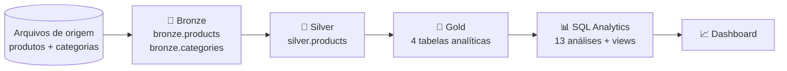

# ⭐ amazon-medallion-databricks

Pipeline de engenharia de dados com **Arquitetura Medallion** (Bronze → Silver → Gold) no **Databricks**, processando **1.426.337 produtos da Amazon em 248 categorias** com PySpark, SQL e Delta Lake, até a camada de SQL Analytics e dashboard.


> 🇺🇸 **Summary:** end-to-end data engineering project on Databricks. 1.43M Amazon products across 248 categories flow through Bronze, Silver and Gold Delta tables (data profiling, enrichment, business metrics), then feed 13 SQL analyses and a dashboard layer. A v2 review fixed discount and rating logic issues found during data analysis.

---

## 🎯 Problema de negócio

Um catálogo de e-commerce com mais de 1,4 milhão de produtos só gera valor se estiver **limpo, padronizado e organizado para análise**. O projeto transforma dados brutos de produtos (preço, avaliação, reviews, best seller, compras no último mês) em uma base confiável para responder:

- Como o catálogo se distribui entre categorias e faixas de preço?
- Onde estão os descontos e as melhores avaliações?
- O que diferencia os produtos Best Seller dos demais?
- Quais categorias concentram mais compras?

---

## 🏗️ Arquitetura



| Camada | O que acontece | Tabelas |
|---|---|---|
| **Bronze** | Ingestão dos dados como chegaram, em formato Delta, mais *data profiling* (estrutura, nulos, duplicidade, integridade produto × categoria) | `bronze.products` (1.426.337) · `bronze.categories` (248) |
| **Silver** | Join com categorias, deduplicação por `asin` e criação de métricas e classificações de negócio | `silver.products` (1.426.337 linhas, 18 colunas) |
| **Gold** | Modelagem analítica pronta para SQL e BI | `gold.product_analysis` · `gold.category_summary` · `gold.best_sellers` (8.520) · `gold.discount_analysis` |

---

## 🧰 Stack

Databricks · PySpark · Spark SQL · Delta Lake · Python

---

## 🔬 O que foi construído

### 🥉 Bronze: ingestão e profiling
- Tabelas Delta criadas por `CREATE OR REPLACE TABLE ... USING DELTA` a partir das tabelas de origem.
- **Profiling antes de transformar:**

| Verificação | Resultado |
|---|---|
| Registros em `products` / `categories` | 1.426.337 / 248 |
| Valores nulos (11 colunas de produtos) | **0** |
| `asin` duplicado | **0** |
| Produtos sem categoria correspondente (left join) | **0** |

### 🥈 Silver: limpeza e enriquecimento
Join produtos × categorias (left), `dropDuplicates(["asin"])` e as colunas derivadas:

| Coluna | Regra |
|---|---|
| `discount_amount` | `listPrice - price`, somente quando `price > 0` e `listPrice > price`; senão 0 |
| `discount_percentage` | `(listPrice - price) / listPrice × 100` sob a mesma condição; senão 0 |
| `is_discounted` | "Yes" quando `discount_amount > 0` |
| `price_range` | Low (< 50) · Medium (< 200) · High (≥ 200) |
| `rating_category` | Unrated (0) · Excellent (≥ 4,5) · Good (≥ 4,0) · Average (≥ 3,0) · Poor (< 3,0) |
| `weighted_rating` | `stars × log10(reviews + 1)`, que pondera a nota pelo volume de avaliações |
| `best_seller_flag` | "Yes"/"No" a partir de `isBestSeller` |
| `etl_timestamp` | Data/hora da execução do ETL |

### 🥇 Gold: modelagem analítica

| Tabela | Conteúdo |
|---|---|
| `gold.product_analysis` | Base principal, 14 colunas por produto |
| `gold.category_summary` | Por categoria: nº de produtos, preço médio, desconto médio, nota média, total de compras |
| `gold.best_sellers` | Somente produtos Best Seller (8.520) |
| `gold.discount_analysis` | Por faixa de preço: nº de produtos, nº de produtos com desconto, desconto médio (geral e só entre os descontados) e preço médio |

### 📊 SQL Analytics
13 blocos de análise sobre a camada Gold: KPIs gerais, distribuição por categoria (com % do catálogo via *window function*), preços, descontos, avaliações, Best Sellers, popularidade, preço × popularidade, desempenho e **ranking de categorias com `RANK() OVER`**, mais **views persistentes** (`gold.vw_dashboard_*`) para alimentar o dashboard.

### 📈 Dashboard
Layout em 5 linhas: KPIs, visão comercial, comportamento de preço, qualidade e popularidade, rankings.


<!-- INSERIR: print do dashboard publicado no Databricks -->

---

## 🔧 Revisão v2: problemas encontrados e correções

Na análise dos resultados da primeira execução, encontrei inconsistências de qualidade e corrigi o pipeline:

| # | Problema encontrado | Correção aplicada | Antes | Depois |
|---|---|---|---|---|
| 1 | **Desconto negativo.** Produtos sem preço de lista (`listPrice = 0`) geravam `discount_amount` negativo, e alguns casos com `listPrice < price` geravam percentuais negativos | Desconto só é calculado quando `price > 0` e `listPrice > price`; caso contrário, 0 | Percentual mínimo de **-781,56%** | [PREENCHER: mínimo após reexecução] |
| 2 | **"Descontos" de 100%** em itens com `price = 0`, que provavelmente estão indisponíveis | Mesma regra acima (exige `price > 0`) | Máximo de **100%** | [PREENCHER: máximo após reexecução] |
| 3 | **Produtos sem nota classificados como "Poor"** (a categoria tinha média de 0,22 estrela) | Nova classe `Unrated` para `stars = 0` | *Poor*: 146.526 (10,27%) | *Poor*: [PREENCHER] · *Unrated*: [PREENCHER] |
| 4 | **Views temporárias** (`TEMP VIEW`) sumiam ao fim da sessão | Views persistentes em `gold.vw_dashboard_*` | 0 views persistentes | 5 views persistentes em `gold` (`vw_dashboard_kpis`, `_categories`, `_price_range`, `_rating` e `_best_sellers`) |
| 5 | **Média de desconto distorcida** | Média geral mantida e nova média **apenas entre produtos com desconto** (`avg_discount_when_discounted`) | Desconto médio: 5,06% | Geral: [PREENCHER] · Só descontados: [PREENCHER] |

Também adicionei uma **célula de validação** no fim da Silver (`negative_discount_amount`, `invalid_discount_pct`, `unrated_products`, `products_without_price`), que deve retornar zero nas duas primeiras métricas:

| Validação Silver | Resultado |
|---|---|
| Desconto negativo | [PREENCHER: deve ser 0] |
| Percentual de desconto inválido (< 0 ou ≥ 100) | [PREENCHER: deve ser 0] |
| Produtos `Unrated` | [PREENCHER] |
| Produtos sem preço (`price = 0`) | [PREENCHER] |

---

## 📊 Principais resultados

**Visão geral do catálogo**

| Indicador | Valor |
|---|---|
| Produtos | 1.426.337 |
| Categorias | 248 |
| Preço médio | 43,38 |
| Avaliação média | 4,00 |
| Compras no último mês (soma) | 202.514.600 |
| Desconto médio | [PREENCHER após reexecução] |

**Insights**

- 🛍️ **Itens baratos dominam o volume.** A faixa *Low* (< 50) tem 83,7% dos produtos e **93,7% das compras**. A faixa *High* (≥ 200) tem 2,8% dos produtos e só 0,4% das compras. A média de compras por produto cai de 158,9 (Low) para 61,7 (Medium) e 22,4 (High).
- 🏆 **Best Sellers são raros e muito eficientes.** São 0,6% do catálogo (8.520 produtos) e respondem por **9,8% das compras**. Em média têm nota maior (4,49 vs 4,00), muito mais reviews (≈ 2.319 vs ≈ 168) e preço menor (29,72 vs 43,46).
- 📦 **Categorias que mais vendem** (com pelo menos 100 produtos): Kitchen & Dining (10,4 mi), Hair Care Products (8,0 mi) e Industrial & Scientific (7,1 mi).
- ⭐ **Qualidade percebida alta.** 49,9% dos produtos estão como *Excellent* e 31,2% como *Good*. Categorias mais bem avaliadas: Gift Cards (4,83) e Health & Household (4,57).
- 🧱 **Catálogo pulverizado.** A maior categoria (Girls' Clothing) tem só 2,0% dos produtos, então não há concentração extrema.
- 💻 **Maior preço médio:** Computer Servers (1.534,22) e Computers & Tablets (544,38).
- 💸 **Descontos:** [PREENCHER após reexecução: categorias com maior desconto médio entre os produtos descontados].

---

## ⚠️ Limitações conhecidas

- **Compras como estimativa.** `boughtInLastMonth` aparece em valores arredondados (100, 2.000, 100.000), o que sugere faixas, não contagens exatas.
- **Reviews zerados na origem.** Há produtos com nota maior que zero e `reviews = 0`, o que zera o `weighted_rating` deles.
- **Produtos sem preço** (`price = 0`) continuam na faixa *Low* de `price_range`.

---

## 🗺️ Roadmap

- [ ] Checagens de qualidade automatizadas entre as camadas
- [ ] `OPTIMIZE` / `ZORDER` com medição de desempenho antes e depois
- [ ] Orquestração com Databricks Workflows e carga incremental
- [ ] Integração com serviços de cloud (AWS)

---

## 📁 Estrutura do repositório

```
amazon-medallion-databricks/
├── notebooks/
│   ├── 00_Introducao.ipynb
│   ├── 01_Bronze_Data_Ingestion.ipynb
│   ├── 02_Silver_Data_Transformation.ipynb
│   ├── 03_Gold_Data_Modeling.ipynb
│   ├── 04_SQL_Analytics.ipynb
│   └── 05_Dashboard.ipynb
├── docs/
│   └── screenshots/      # dashboard, tabelas e workflow
└── README.md
```

---

## ▶️ Como reproduzir

1. Crie uma conta gratuita no [Databricks Free Edition](https://www.databricks.com/learn/free-edition).
2. Baixe o dataset: [INSERIR: link da fonte].
3. Carregue os arquivos como as tabelas `amazon_products` e `amazon_categories` (schema `default`).
4. Importe os notebooks e execute na ordem `01 → 05`.

---

## 🧠 Decisões técnicas

- **Medallion:** separa responsabilidades e permite reprocessar uma camada sem refazer as outras.
- **Delta Lake:** transações ACID e base para evoluir para cargas incrementais.
- **Profiling antes da Silver:** os testes de nulos, duplicidade e integridade (todos zerados) comprovaram a qualidade da origem antes de transformar.
- **`weighted_rating`:** evita que um produto com nota 5,0 e uma única avaliação supere um com nota 4,7 e 177 mil reviews.
- **Revisão orientada a dados (v2):** os problemas de desconto e de avaliação foram achados lendo os próprios resultados do pipeline, o que mostra por que validar cada camada importa.
- **Gold orientada a consumo:** tabelas já agregadas por categoria e faixa de preço reduzem o custo das consultas de BI.

---

## 👤 Autor

**Leonardo Monaro** · [LinkedIn](https://www.linkedin.com/in/SEU-USUARIO/)
