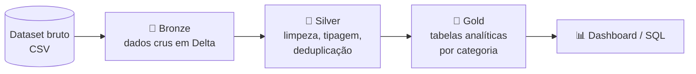

# ⭐ amazon-medallion-databricks

Pipeline ETL com **Arquitetura Medallion** (Bronze → Silver → Gold) no **Databricks**, processando ~1,4 milhão de produtos da Amazon em 248 categorias, com PySpark, SQL e Delta Lake.


> 🇺🇸 **Summary:** end-to-end data engineering project. Raw Amazon product data (~1.4M rows, 248 categories) is ingested, cleaned and modeled through Bronze, Silver and Gold Delta tables on Databricks, ending in analytics-ready tables and a dashboard.

---

## 🎯 Problema de negócio

Dados brutos de catálogo de e-commerce chegam inconsistentes (preços como texto, nulos, duplicados, categorias soltas). O objetivo é criar uma base **confiável e reutilizável** para responder perguntas como:

- Qual o preço médio e a faixa de preço por categoria?
- Quais categorias concentram mais produtos bem avaliados?
- Como se distribuem avaliações, descontos e preços entre categorias?

<!-- PREENCHER: ajuste as perguntas às que o seu Gold realmente responde -->

---

## 🏗️ Arquitetura



| Camada | Objetivo | Principais transformações |
|---|---|---|
| **Bronze** | Preservar o dado como chegou | Ingestão do CSV, metadados de carga (data, origem) |
| **Silver** | Dado limpo e confiável | Tipagem, tratamento de nulos, remoção de duplicados, padronização de texto/preço |
| **Gold** | Pronto para análise | Agregações por categoria, métricas de preço e avaliação |

<!-- PREENCHER: confira se a tabela reflete exatamente o que o seu código faz -->

---

## 🧰 Stack

Databricks · PySpark · Spark SQL · Delta Lake · Python

---

## 📁 Estrutura do repositório

```
amazon-medallion-databricks/
├── notebooks/
│   ├── 01_bronze_ingestion.ipynb
│   ├── 02_silver_transformation.ipynb
│   └── 03_gold_aggregations.ipynb
├── sql/                  # consultas analíticas sobre a camada Gold
├── docs/
│   ├── architecture.png  # diagrama (opcional, além do Mermaid)
│   └── screenshots/      # prints do workflow e do dashboard
├── data/sample/          # amostra pequena (NÃO suba o dataset completo)
└── README.md
```

---

## ✅ Qualidade de dados

| Verificação | Camada | Resultado |
|---|---|---|
| Linhas de entrada → saída | Bronze → Silver | [PREENCHER] → [PREENCHER] |
| Registros duplicados removidos | Silver | [PREENCHER] |
| Nulos em colunas-chave | Silver | [PREENCHER] |
| Preços inválidos (≤ 0 ou fora do padrão) | Silver | [PREENCHER] |
| Categorias distintas | Gold | 248 |

---

## 📊 Principais resultados

<!-- PREENCHER com 3 a 5 insights reais vindos da camada Gold, por exemplo: -->
- [PREENCHER: insight 1, ex.: categorias com maior preço médio]
- [PREENCHER: insight 2]
- [PREENCHER: insight 3]


---

## 🧠 Decisões técnicas

- **Por que Medallion?** Separa responsabilidades, permite reprocessar uma camada sem refazer as outras e facilita auditoria.
- **Por que Delta Lake?** Transações ACID, *time travel* e `MERGE`, essenciais para evoluir para cargas incrementais.
- **[PREENCHER]** Outras escolhas suas (particionamento, formato de colunas, tratamento de preço etc.) e o motivo.

---

## ⚡ Otimizações

<!-- PREENCHER só com o que você de fato aplicar e medir -->
| Técnica | Antes | Depois |
|---|---|---|
| `OPTIMIZE` / `ZORDER` por categoria | [PREENCHER] s | [PREENCHER] s |
| Particionamento | [PREENCHER] | [PREENCHER] |

---

## ▶️ Como reproduzir

1. Crie uma conta no [Databricks Free Edition](https://www.databricks.com/learn/free-edition).
2. Baixe o dataset: [PREENCHER: link da fonte, ex.: Kaggle].
3. Faça upload para um Volume/DBFS e ajuste o caminho no notebook `01_bronze_ingestion`.
4. Execute os notebooks na ordem `01 → 02 → 03`.

---

## 🗺️ Roadmap

- [ ] Carga incremental com Auto Loader ou `MERGE INTO`
- [ ] Orquestração com Databricks Workflows
- [ ] Testes de qualidade automatizados (pytest) e CI com GitHub Actions
- [ ] Dashboard no Databricks SQL ou Power BI

---

## 👤 Autor

**Leonardo Monaro** · [LinkedIn](https://www.linkedin.com/in/SEU-USUARIO/)
